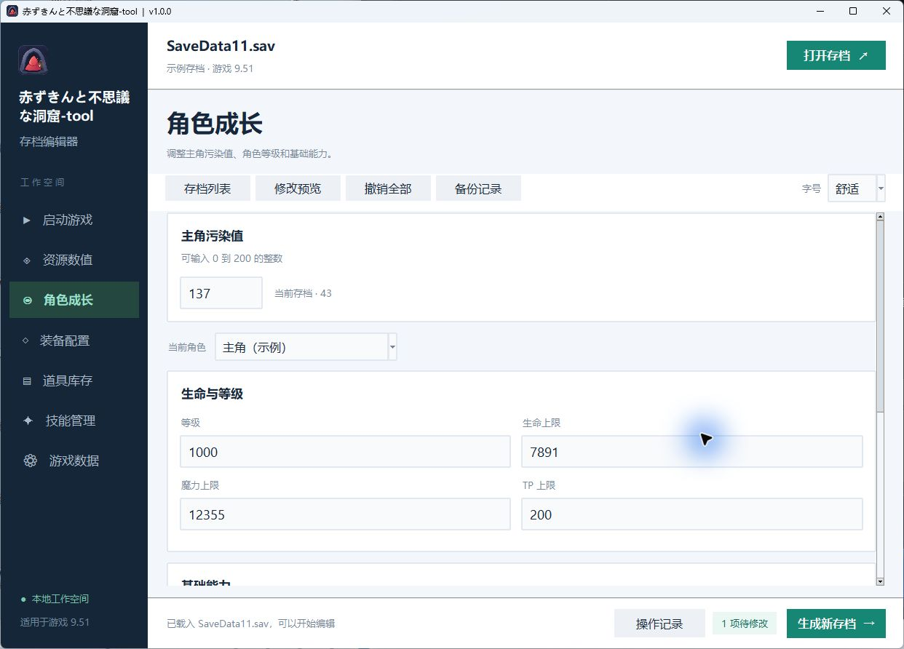

# 赤ずきんと不思議な洞窟-tool


《赤ずきんと不思議な洞窟》（小红帽与不可思议的洞窟、Akasan）**9.51** 的 Windows 单机存档编辑器。打开现有存档，修改主角污染值、金币、元素或角色能力，核对变更后生成一个可在游戏中读取的新槽位。

Windows save editor for **赤ずきんと不思議な洞窟 / Akasan 9.51**.

## 安装与使用

1. 在 Release 的 **Assets** 下载 `AkasanTool-v1.1.0-Windows-x64-Setup.exe`，双击安装。安装包适用于 Windows 10 和 Windows 11 x64，自带运行组件。安装后可从开始菜单启动，安装时也可选择创建桌面快捷方式。[版本下载](https://github.com/wishwide2/cheat-tool/releases/tag/v1.1.0)
2. 在游戏中先保存一次，再在工具里点击「打开存档」，选择游戏 `Save` 文件夹中的 `SaveData*.sav`。
3. 在左栏选择要修改的项目。例如进入「角色成长」，把「主角污染值」从 `43` 填为 `137`。物品和技能修改需要先点击页面里的应用按钮，才会加入修改列表。
4. 点击「修改预览」核对原值与新值，再点「生成新存档」。在 `Save` 里选择一个空槽位，例如 `SaveData02.sav`。工具会在原档所在目录保留一份备份。
5. 回到游戏读取新槽位。也可以在工具的「启动游戏」页选择 `Game.exe` 所在目录，再从工具启动游戏。

## 界面预览

角色成长页可以并排核对原存档的污染值 `43` 和待写入的新值 `137`。



## 可编辑的存档数值

| 页面 | 可以修改的内容 |
| --- | --- |
| 资源数值 | 随身金币 **CHIP**、元素储备 **ELEM**。两项都填整数。 |
| 角色成长 | **主角污染值 0–200**。按角色编辑等级、生命上限 HP、魔力上限 SP、TP 上限、攻击力、防御力、智力、魔法防御、速度和命中。角色能力方案有「冒险起步」「轻松探索」「强力通关」，可应用给当前角色或列表中的全部角色。 |
| 装备配置 | 按角色编辑 **8 个装备槽和 1 个扩展槽**。可从库存中选装备，也可直接填装备编号。 |
| 道具库存 | 修改道具、武器和防具的持有数量，支持按名称或编号搜索以及批量调整。单项数量填 `0` 可清空。名称从当前存档读取，缺少名称时显示编号。 |
| 技能管理 | 按角色和技能格编辑**技能编号、习得等级**。编号 `-1` 清空技能格，等级 `0` 表示起始习得。 |
| 存档与备份 | 存档列表、修改预览、撤销待写入修改、生成空槽位，以及从备份恢复到新槽位。 |

角色成长页编辑的是基础能力和上限，游戏内的最终数值还会计入装备加成。某项能否编辑取决于存档是否包含对应字段。

## 剧情导航

在「启动游戏」页选择自己的 9.51 游戏目录，再打开「剧情导航」。列表按 13 个主线路段和 2 个据点分别显示独立起点和已有记录。列表中的已有记录来自本机 `Save` 文件夹，独立起点来自本机 `Localization/StoryStarts` 中与当前游戏资源匹配的起点清单及存档。

- **带存档跳转**。打开一份已保存的存档，点工具栏的「剧情跳转」，选择目标段落，再点「带存档跳转」。也可以在窗口里另选携带存档。新槽位会继承主角和原队伍成员的等级、属性、装备与技能，以及 Chip、Elem、主角污染值、武器防具库存和常用消耗品及材料。出场队伍、任务、门和剧情物品随目的段落。未生成的修改草稿仍留在编辑器中。
- 本机安装独立起点资源后，选一个段落并点「从该段新开」。工坊会把该段的预设进度、队伍和等级复制到空槽。在游戏的「继续游戏」读取新槽，或者从标题的「剧情导航 → 从指定段落新开」直接进入。
- 「生成新槽位」完整复制所选记录到空槽位。在游戏的「继续游戏」里选择新槽位，回到保存时的位置、队伍、物品和任务状态。
- 本机游戏已安装兼容的标题剧情导航时，可以把普通档「补录到游戏标题」。下次在游戏标题的「剧情导航 → 章节记录」中读取。已有章节记录会保留。
- 已安装游戏内剧情导航时，可以从标题跳过开场，或在普通对话时按住 **F7** 快进。

生成前请先保存并退出游戏，再到「继续游戏」读取生成的新槽位。只要本机有可识别的记录，就可以将它复制到空槽位。「带存档跳转」和「从该段新开」需要本机已有对应的兼容起点资源，标题补录和 F7 快进需要对应的游戏内资源。Windows 安装包提供工坊程序和运行组件。

## 可选的游戏数据修改

「游戏数据」页修改本机游戏的数据包。先退出游戏再应用，应用后重新启动。可保存规则组合，也可恢复所选游戏目录的玩法基线。

| 规则 | 实际修改 |
| --- | --- |
| 商店友好价格 | 道具、武器和防具中高于 `1` 的商店价降为 `1`。 |
| 敌人属性倍率 | **×0.25、×0.5、×0.8、×1、×1.5、×3**。应用到受支持的敌人基础属性。 |
| 满额掉落与收益 | 已配置且大于 `0`、低于 `100%` 的掉落率提高到 **100%**。正数经验和金币收益各 **×3**。 |
| 装备属性倍率 | 武器、防具中受支持的正数属性按 **×1、×1.5、×2、×3、×5** 放大。 |
| 技能零消耗 | 将受支持技能的 SP / TP 消耗设为 **0**。 |

这部分需要本机游戏的 `Data\BasicData.wolf`，以及支持 `-p 3` 的兼容 UberWolf 命令行工具。将 `UberWolfCli.exe` 放到已安装程序旁的 `tools` 文件夹，或把其完整路径设为 `AKASAN_ARCHIVER`。归档工具需要 ASCII 临时路径时，可设置 `AKASAN_TEMP`。[UberWolf 上游](https://github.com/Sinflower/UberWolf)

普通启动直接使用本机游戏已安装的资源。若游戏目录已有兼容的 `Localization` 清单和资源，才会显示对应语言选项。切换使用该清单指定的归档工具版本。

## 文件保存位置

- 程序默认安装在 `%LOCALAPPDATA%\Programs\AkasanTool`。可在 Windows 的「已安装的应用」中卸载。
- 工具偏好和玩法基线保存在 `%LOCALAPPDATA%\AkasanWorkshopPublic`。
- 新存档和自动备份保存在你选择的 `Save` 目录内。原档备份与程序安装目录分开保存。

## 从源码运行或构建

使用带 Tkinter 的 Python 3.13 x64。在项目目录打开 PowerShell。

```powershell
py -3.13 -m venv .venv
.\.venv\Scripts\python.exe -m pip install -r requirements.txt
.\.venv\Scripts\python.exe .\akasan_editor.py
```

用 PyInstaller 构建 `dist\AkasanTool.exe`，再用 Inno Setup 6.7 编译安装包。`$innoCompiler` 填本机的 `ISCC.exe` 完整路径。发布构建使用 Python 3.13.12 x64，改用其他运行时版本时同步更新安装包内的第三方许可文件。[Inno Setup 官方下载](https://jrsoftware.org/isdl.php)

```powershell
.\.venv\Scripts\python.exe -m pip install -r requirements-build.txt
.\.venv\Scripts\python.exe -m PyInstaller --noconfirm .\AkasanWorkshop.spec
$innoCompiler = "${env:ProgramFiles(x86)}\Inno Setup 6\ISCC.exe"
& $innoCompiler .\installer\AkasanTool.iss
```

## 许可

MIT 许可适用于本项目自有的源码和工坊图标。原游戏由マインドトラップ（邪心）制作。游戏程序、剧情和翻译资源、存档及可选归档工具由使用者在本机提供。安装包的运行时许可随软件安装。[MIT 许可证](LICENSE) · [第三方说明](THIRD_PARTY_NOTICES.md)
